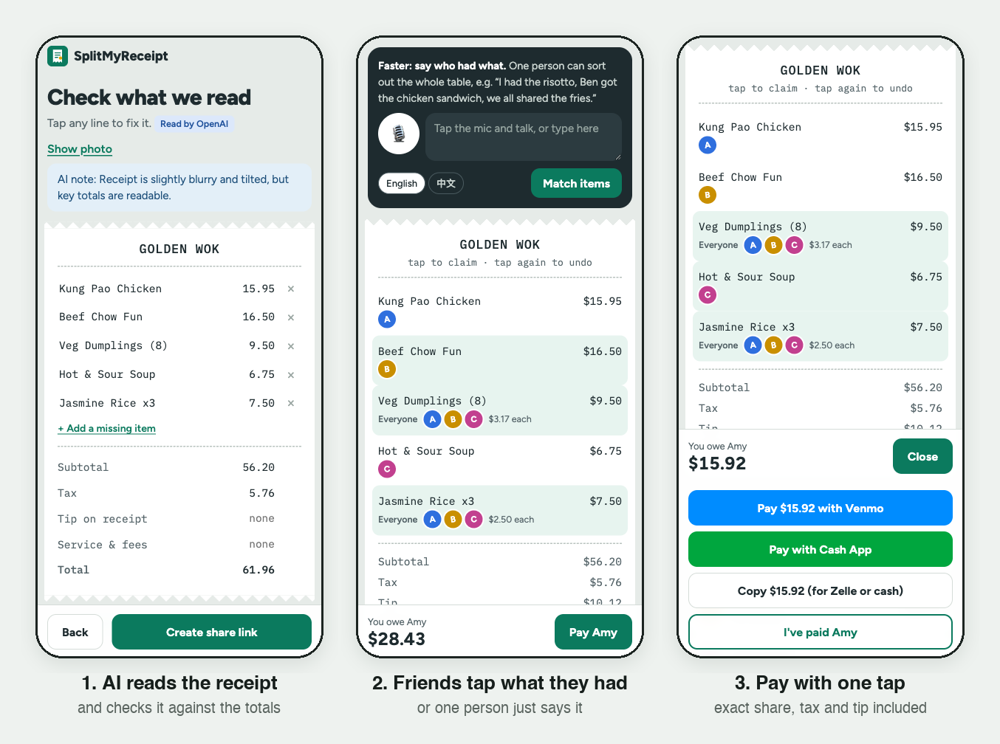

# 🧾 SplitMyReceipt

Snap the receipt, share one link, and everyone taps what they ate — or one person just *says* who had what. Each friend sees their exact share (tax, tip and fees included) and pays you with one tap. No app download, no sign-up.

**Live demo: https://splitmyreceipt.onrender.com** — open it on your phone. It runs real AI (OpenAI). The free plan sleeps when idle, so the first load can take about a minute.



[Try it](#try-it-in-2-minutes) · [How it works](#how-it-works) · [Run locally](#run-locally) · [Dependencies](#dependencies) · [Roadmap](docs/ROADMAP.md) · [Edge cases](docs/EDGE_CASES.md)

## The problem

After a group meal one person pays, then has to (1) find out who had what, usually by asking around in a group chat, (2) do the math, including tax and tip, and (3) chase everyone for money. Splitting evenly is unfair when orders differ; splitting exactly is slow and error-prone.

Existing apps (Splitwise, Tab, Forks, SplitBill AI) already scan receipts. In their App Store reviews people complain about misread receipts (subtotal/tax treated as items, a phantom tip, tax recorded as $0), features behind paywalls, and friends having to install the app to join. SplitMyReceipt focuses on:

- **Zero friction for friends:** a web link, nothing to install.
- **Fast assignment:** say who had what in one sentence.
- **Numbers you can trust:** AI output is checked against the receipt's own printed totals, and all money math is plain code.

## Try it in 2 minutes

On https://splitmyreceipt.onrender.com:

1. Tap the **"Blurry photo"** sample. The AI reads it in about 2 seconds and shows "✓ It all adds up: items $56.20 + tax $5.76 = $61.96".
2. To see the cross-check catch a misread, change **Beef Chow Fun** to `6.50`: "Items add up to $46.20 but the receipt subtotal says $56.20 (off by $10.00)…". Change it back to `16.50` and the warning clears.
3. Choose an **18%** tip ($10.12), enter **Amy** as your name and any Venmo handle (e.g. `@amy`) so the pay buttons appear, and tap **Create share link**.
4. On the bill page, type or say *"I had the kung pao chicken, everyone shared the dumplings and the rice"* → **Match items** → **Apply**.
5. Open the bill link in a private window as **Ben** and tap Beef Chow Fun; in another private window as **Chen**, tap Hot & Sour Soup. Each window updates within a few seconds. (Who you are is remembered per browser, so use one private window per person.)

| Person | Owes |
|---|---|
| Amy (paid the bill) | $27.73 |
| Ben | $28.43 |
| Chen | $15.92 |
| **Total** | **$72.08** = $56.20 food + $5.76 tax + $10.12 tip |

Ben and Chen can now pay Amy through Venmo or Cash App with the amount filled in; Amy sees who still owes and can send a reminder. These amounts were checked against the live deploy.

### Sample data (all synthetic)

| Sample | Case | Expected |
|---|---|---|
| "Dinner for 3" — `1_lulas_kitchen.png` | Representative: the full workflow | "✓ It all adds up: items $68.25 + tax $5.97 + tip $13.65 = $87.87". Amy (payer) says *"I had the risotto, we all shared the fries and the iced tea"*; Ben claims the chicken sandwich and the beer, Chen the Caesar salad → **Amy $30.05, Ben $36.48, Chen $21.34** (total $87.87) |
| "Blurry photo" — `2_golden_wok_blurry.png` | Difficult: blurry, tilted, no printed tip | Read correctly by the AI; edit a price to see the cross-check (in demo mode it is misread on purpose, see [AI modes](#ai-modes)) |
| "Not a receipt" — `3_not_a_receipt.png` | Invalid input | ⛔ "That doesn't look like a receipt" — cannot create a bill |

## How it works

1. **Payer snaps the receipt.** The AI (OpenAI or Gemini) reads items, tax, tip, service charges/fees and total into a fixed JSON schema.
2. **Check.** Items are cross-checked against the printed subtotal and total; mismatches, non-receipts, odd tax and a tip that isn't in the total (often just a printed "suggested tip") are flagged. Every line is editable, and a tip can be added if none was charged.
3. **Share the link.** Friends open `/b/<id>`, pick or type their name, and tap the dishes they had. Everyone's screen updates live.
4. **Or say it.** "I had the kung pao chicken, Ben got the chow fun, we all shared the dumplings." The AI maps the sentence to items and people (English or Chinese); the app shows the proposal and **nothing changes until you tap Apply**. "Everyone" means *the whole table*, so friends who join later are included automatically.
5. **Pay.** When every item is claimed, each friend taps **Pay Amy** → Venmo or Cash App opens with their share (e.g. $28.43) filled in, or they copy it for Zelle; then they tap "I've paid". If their share changes later, the app shows what's still due.

### Where AI is used — and where it isn't

| Task | How | Why |
|---|---|---|
| Read the receipt photo | OpenAI or Gemini, strict JSON Schema output | Photos are messy; rules can't do this |
| Understand "who had what" | Browser speech-to-text → AI maps text to item indexes | Natural language, nicknames, English/Chinese |
| Guard the AI's output | Plain code: fee/gratuity lines listed as dishes are moved out, malformed proposals are cleaned, empty or refused answers fall back to the next model | The model's JSON is untrusted input |
| Check the reading | Plain code: items vs subtotal, sum vs total, tip missing from the total | The receipt's printed totals are a free checksum |
| All money math | Plain code, integer cents, largest-remainder rounding | AI arithmetic isn't reliable; shares must add up exactly |
| Apply anything to the bill | Only after the user confirms | AI proposes, people decide |

Typical latency on the live deploy (`gpt-5.4-mini`): about 2 s to read a receipt and about 2 s to match a sentence.

### Design decisions

- **Integer cents everywhere.** Shared items split evenly; tax, tip and fees are allocated in proportion to each person's items with the largest-remainder method, so shares always add up to the exact total (asserted on every split).
- **Discounts never make a share negative.** An unclaimed discount comes off everyone in proportion; a claimed one brings its claimers down to $0 at most, and the rest is shared by the table.
- **Live preview while claiming.** Unclaimed items sit in a hidden bucket that takes its share of tax and tip, so your number doesn't jump when someone else claims a dish.
- **Paid means "paid this amount".** The app records how much each friend paid, so a later change to their share shows up as still due.
- **Keys stay on the server.** The browser never sees an API key; with no key the app runs in a clearly labeled demo mode.

## Run locally

Python 3.10+ (tested on 3.12 and 3.13).

```bash
python3 -m venv .venv && source .venv/bin/activate
pip install -r requirements.txt
cp .env.example .env               # optional: add OPENAI_API_KEY or GEMINI_API_KEY for real AI
uvicorn server:app --reload        # open http://localhost:8000
pytest -q                          # 76 tests
```

Or with Docker (bills are kept in the `smr-data` volume):

```bash
docker build -t splitmyreceipt .
docker run --rm splitmyreceipt pytest -q
docker run -d -p 8000:8000 -v smr-data:/data --env-file .env splitmyreceipt   # drop --env-file for demo mode
```

To try several people locally, open the bill link in private windows. Voice input needs HTTPS or localhost, so on a phone use the live demo for voice.

### AI modes

- **Demo mode (no key):** receipt reading is **mocked**: the three samples return pre-recorded extractions from `samples/*.json`, and voice/text uses a simple keyword matcher. Both are labeled in the UI. In this mode the blurry sample is deliberately misread (Beef Chow Fun as $6.50) to show the cross-check.
- **AI mode:** set `OPENAI_API_KEY` (models `gpt-5.4-mini` → `gpt-5.4-nano`) or `GEMINI_API_KEY` (`gemini-flash-latest` → `gemini-flash-lite-latest`). If both are set, OpenAI is used unless `AI_PROVIDER=gemini`; model lists can be overridden with `OPENAI_MODELS` / `GEMINI_MODELS`. With a key, the bundled samples are read by the AI too (same path as your own photos); the mocked `samples/*.json` are only used in demo mode.
- **When the AI is busy** (503, 429, timeouts) the server retries with a short backoff, then falls back to the next model; an empty or refused answer also moves on. Bad keys fail immediately with a clear message, and the receipt always stays editable by hand.

## Dependencies

| Package | Used for |
|---|---|
| `fastapi`, `uvicorn`, `pydantic`, `python-multipart` | Web server, JSON API, request validation, photo uploads |
| `pillow` | Photo clean-up before the AI: EXIF rotation, size limits, JPEG conversion |
| `openai`, `google-genai` | AI providers (only the configured one is called) |
| `python-dotenv` | Reads `.env` locally |
| `pytest`, `httpx` | Tests |

- **Frontend:** plain HTML, CSS and JavaScript; no framework and no build step. Voice uses the browser's Web Speech API. Fonts (Figtree, IBM Plex Mono) load from Google Fonts.
- **External services:** the OpenAI or Gemini API (optional; demo mode needs none). Venmo and Cash App are only linked to; no money moves through the app.
- **Runtime:** Python 3.10+, or Docker. Deployed on Render's free plan.

## Project layout

```
server.py         FastAPI: receipt API, shared bills, voice-assign, paid status; serves the web app
ai_client.py      The single AI caller: OpenAI or Gemini, retries, model fallback, friendly errors
extractor.py      Receipt reading (prompt + JSON Schema), fee/gratuity safety net, demo mock
assigner.py       Sentence -> proposed assignments (AI, or keyword matcher in demo); cleans the model's output
splitter.py       Validation + exact split (no AI); live preview while items are unclaimed
static/           Mobile web app: index.html, app.js, style.css
samples/          Synthetic receipts + mocked extractions; make_samples.py regenerates them
tests/            pytest: splitter, assigner, AI client, end-to-end API, fees, edge-case regressions
docs/             Roadmap, edge cases, screenshots
Dockerfile        Container image (single worker, bills in a /data volume)
render.yaml       One-click deploy config for Render
```

## Deploy (free) on Render

The live demo is deployed from this repo: **New → Blueprint** on https://render.com, pick the repo (it uses `render.yaml`), and set `OPENAI_API_KEY` or `GEMINI_API_KEY`. Without a key it runs in demo mode.

Anyone with the link triggers AI calls on your key, so set a monthly budget limit with your provider. On the free plan the service sleeps when idle, and its disk is temporary: bills disappear on every restart or redeploy, including the automatic one after a push.

## Status

- **Implemented:** AI receipt reading (OpenAI or Gemini), validation and editing, fees and suggested-tip detection, shareable bill link, live multi-person claiming, voice/text assignment with confirmation, exact proportional split, Venmo/Cash App deep links, paid tracking, reminders, retry and model fallback, Docker image, live deploy, 76 automated tests.
- **Mocked / simplified:** AI output and the assignment matcher in demo mode; payments are deep links and "I've paid" is self-reported; identity is a name on the bill (no accounts); storage is one JSON file per bill; live updates poll every 2.5 s.

**Next investigation:** benchmark 20–30 real receipts (line accuracy, edits needed, checksum catches) and observe 3–5 real dinners (claim rate, time until everyone has paid) before building more.

**Deferred / next steps** ([full roadmap](docs/ROADMAP.md), 16 items): a payer admin link to fix the bill and people after sharing, per-unit and uneven shares, an AI accuracy evaluation on real receipts (OpenAI vs Gemini), and CI with browser end-to-end tests.

**Edge cases** ([full list](docs/EDGE_CASES.md), 55 cases): 22 covered by automated tests, 6 checked by hand, 27 known gaps. The most important gaps: the suggested-tip warning also fires for a real handwritten tip when the printed total is the pre-tip amount; `12,50` is read as $1,250.00; two different people with the same name are merged; and anyone with the link can claim or mark paid for anyone.

## Time spent & how AI was used

- **Time spent:** about 3.5 hours.
- **How AI was used:** I worked with an AI coding assistant (Claude Code) as a pair programmer:
  - **Brainstorming and research:** candidate problems, existing apps and their reviews, requirements and product scope, which steps need AI and which must be plain code, and what could go wrong.
  - **Writing code:** the FastAPI server, the mobile frontend, prompts and JSON schemas, tests, and the Dockerfile.
  - **Review:** an edge-case review of the working prototype. Each fix started with a failing test; the cases that are still open are listed in [docs/EDGE_CASES.md](docs/EDGE_CASES.md).
  - **Docs:** drafting this README and the docs folder.
- **How I checked it:** I made the product decisions and reviewed every change. All money math is plain code covered by tests; the 76 tests run in Docker; and the walkthrough above was run on the live deploy with several browsers at phone width.
- **Prior work reused:** none; built from scratch for this case study.
